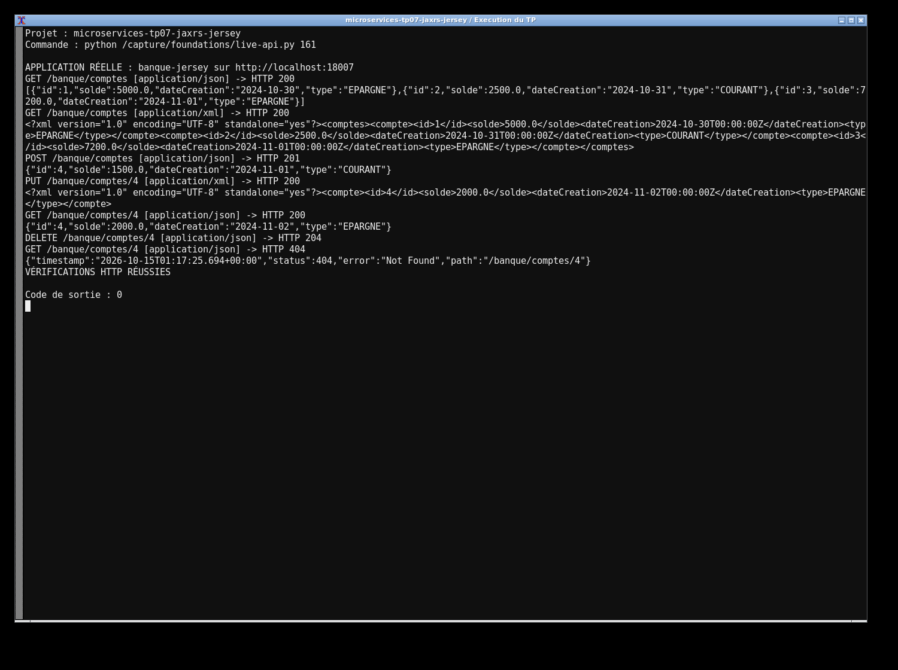
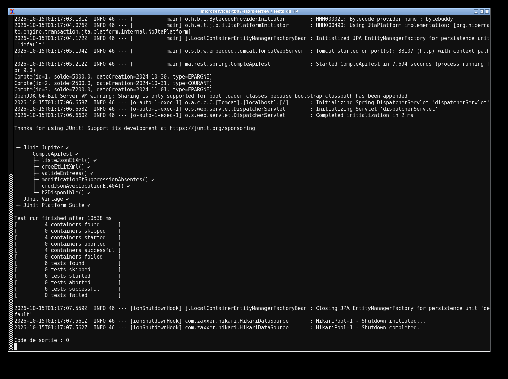

# TP7 — JAX-RS avec Jersey

J'ai réalisé l'API bancaire avec Jersey et Spring Data JPA. Les méthodes de `CompteRestJaxRSAPI` utilisent les annotations JAX-RS (`@GET`, `@POST`, `@PUT`, `@DELETE`). `MyConfig` enregistre la ressource dans `ResourceConfig`. Trois comptes sont chargés au démarrage dans H2.

J'utilise Java 17 et Maven. Pour lancer le projet :

```sh
mvn clean verify
mvn spring-boot:run
```

Les routes sont accessibles à `http://localhost:8082/banque/comptes`. L'en-tête `Accept` choisit JSON ou XML ; POST et PUT acceptent les deux formats. JAXB utilise `@XmlRootElement` sur `Compte`. La création renvoie 201 et la suppression 204. Une ressource absente renvoie 404. La console H2 se trouve à `/h2-console` avec `jdbc:h2:mem:banque`, utilisateur `sa` et mot de passe vide. Les tests envoient de vraies requêtes HTTP au serveur embarqué.

Les captures montrent l'exécution réelle du projet et des tests sur ma machine.



